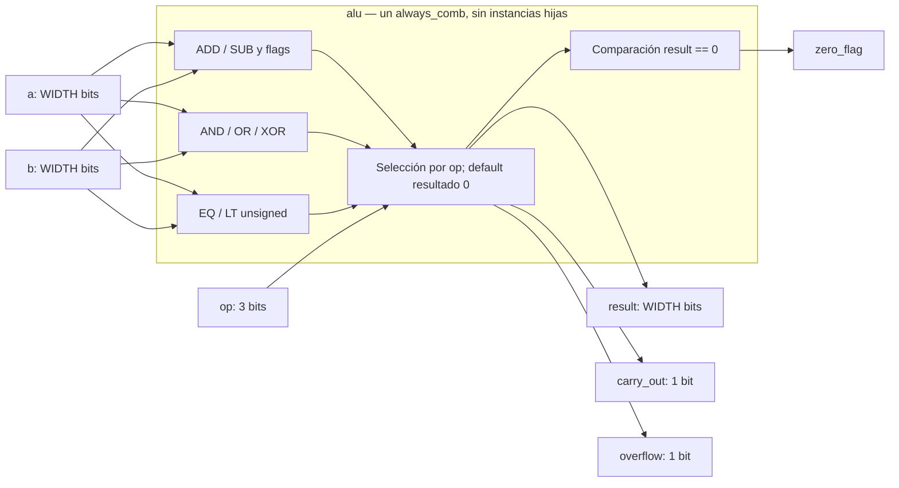

# Módulo: `alu`

> Documentación conforme al
> [OpenCE Hardware RTL Documentation Template](https://opencehardware.github.io/RTL-Hardware-Documentation-Template/).
> RTL: `template/lib/alu/alu.sv`.
> Verificación: `template/tests/alu/`.

## Revisions

| Versión | Fecha | Cambio |
|---|---|---|
| 1.0 | 2026-09-08 | Primera versión alineada con el RTL parametrizable, las pruebas CocoTB/PyTest y el ejercicio didáctico de fallo/paso. |
| 1.1 | 2026-10-05 | Esquema Mermaid, flag de opcode reservado y simulación parametrizada real. |

## Document Conventions

| Término | Significado |
|---|---|
| DUT | Módulo bajo prueba. |
| `WIDTH` | Ancho de datos en bits. |
| `op` | Opcode de 3 bits que selecciona la operación. |
| `zero_flag` | Bandera que vale 1 cuando `result == 0`. |
| `carry_out` | Acarreo de ADD y bit "sin préstamo" de SUB. |
| `overflow` | Overflow con interpretación signed en ADD y SUB. |

Las señales y puertos usan minúsculas con guion bajo. Los parámetros y opcodes
documentados se expresan en mayúsculas.

## Introduction

`alu` es una unidad aritmético-lógica combinacional y parametrizable, pensada
como bloque de referencia pequeño para la infraestructura de verificación del
curso. Su objetivo no es competir con una IP compleja, sino ofrecer un ejemplo
que el estudiante pueda entender, romper deliberadamente y reparar mientras ve
cómo el mismo pipeline detecta el fallo y vuelve a pasar.

Características:

- Parámetro `WIDTH` con valor predeterminado de 8 bits.
- Operaciones `ADD`, `SUB`, `AND`, `OR`, `XOR`, `EQ` y `LT`.
- Salida `result` de `WIDTH` bits.
- Banderas `zero_flag`, `carry_out` y `overflow`.
- Sin reloj ni estado interno: el comportamiento es puramente combinacional.
- Comparaciones codificadas como palabra de `WIDTH` bits con solo el bit 0
  significativo.

La comparación `LT` es **unsigned**. El flag `overflow` aplica únicamente a
`ADD` y `SUB` bajo interpretación signed en complemento a dos.

## Block Diagram

```text
 a[WIDTH-1:0] ──┐
                │
 b[WIDTH-1:0] ──┼──► lógica combinacional (sumador/restador + lógica + comparador)
                │
       op[2:0] ─┘
                           ├──► result[WIDTH-1:0]
                           ├──► zero_flag
                           ├──► carry_out
                           └──► overflow
```

**Esquema de microarquitectura RTL conceptual (no netlist ni circuito físico):**



El dibujo separa funciones para explicarlas; el sintetizador decide si
comparte o replica recursos. Los nodos internos no son submódulos ni unidades
físicas independientes: corresponden a expresiones del único `always_comb`.
La frontera y los siete puertos coinciden con el RTL.

## Configuration

### Parámetros

| Parámetro | Tipo | Valor inicial | Rango válido | Descripción |
|---|---|---:|---|---|
| `WIDTH` | `int unsigned` | 8 | `WIDTH >= 1` | Ancho de `a`, `b` y `result`. |

### Puertos

| Señal | Dirección | Ancho | Descripción |
|---|---|---:|---|
| `a` | entrada | `WIDTH` | Operando A. |
| `b` | entrada | `WIDTH` | Operando B. |
| `op` | entrada | 3 | Selección de operación. |
| `result` | salida | `WIDTH` | Resultado principal. |
| `zero_flag` | salida | 1 | Vale 1 cuando `result` es cero. |
| `carry_out` | salida | 1 | Acarreo de ADD; en SUB, 1 significa ausencia de préstamo. |
| `overflow` | salida | 1 | Overflow signed en ADD/SUB; 0 en operaciones lógicas y comparaciones. |

### Codificación de opcodes

| Opcode | Mnemónico | Descripción |
|---:|---|---|
| `3'b000` | `OP_ADD` | Suma `a + b`. |
| `3'b001` | `OP_SUB` | Resta `a - b`. |
| `3'b010` | `OP_AND` | AND bit a bit. |
| `3'b011` | `OP_OR` | OR bit a bit. |
| `3'b100` | `OP_XOR` | XOR bit a bit. |
| `3'b101` | `OP_EQ` | `result[0]=1` cuando `a == b`. |
| `3'b110` | `OP_LT` | `result[0]=1` cuando `a < b` (unsigned). |
| `3'b111` | Reservado | Devuelve `result=0`, `zero_flag=1`, `carry_out=0`, `overflow=0`. |

## Protocols

**No aplica.** El módulo no implementa un protocolo de transacción; responde de
forma combinacional a cambios en `a`, `b` y `op`.

## Memory Map

**No aplica.** No existe una interfaz direccionable ni registros mapeados en
memoria.

## Registers

**No aplica.** La ALU es puramente combinacional y no contiene elementos de
estado.

## Clock Domains

**No aplica.** El módulo no usa reloj. La integración de sistema puede
conectarlo a cualquier dominio que garantice tiempos de propagación adecuados.

## Reset Domains

**No aplica.** No hay estado que resetear dentro del bloque.

## Interrupts

**No aplica.** El módulo no genera ni consume interrupciones.

## Arbitration

**No aplica.** No existen múltiples solicitantes ni recursos compartidos.

## Debugging

Las señales recomendadas para observar en simulación son:

- `a`, `b` y `op`.
- `result`.
- `zero_flag`, `carry_out` y `overflow`.

El directorio `template/tests/alu/` incluye además
`test_alu_broken_example.md`, que documenta una mutación manual del RTL para
que el estudiante vea cómo el test pasa con el RTL correcto y falla cuando se
rompe `OP_SUB`.

## Synthesis

La síntesis lógica abierta se ejecuta con Yosys 0.40:

```bash
make synth DESIGN=alu TOPLEVEL=alu WIDTH=8
```

El flujo usa:

```text
synth_intel_alm -family cyclonev
```

`make synth-all` incluye la ALU con `WIDTH=8` y `WIDTH=32`, además del
contador y el skid buffer. La evidencia producida es una red JSON con mapeo a
celdas `MISTRAL_*`. Esta comprobación no representa place-and-route, Fmax,
bitstream ni cumplimiento de timing; Quartus y Timing Analyzer siguen siendo la
autoridad para la implementación física.

## Verification

La verificación usa la misma convención de cuatro piezas del proyecto:

| Archivo | Responsabilidad |
|---|---|
| `stimulus.py` | Casos dirigidos y pseudoaleatorios deterministas con semilla. |
| `model.py` | Modelo de referencia puro en Python para cada opcode y bandera. |
| `checker.py` | Comparación entre observaciones esperadas y reales. |
| `tb_alu.py` | Driver CocoTB que aplica estímulos y captura salidas. |

`test_alu.py` agrega pruebas unitarias y ejecuta la simulación vía `make sim`.

Cobertura funcional prevista:

1. Cada opcode soportado.
2. `zero_flag` en resultados nulos.
3. `carry_out` en suma con acarreo y resta con préstamo.
4. `overflow` signed en `ADD` y `SUB`.
5. Comparaciones `EQ` y `LT`.
6. Secuencias pseudoaleatorias reproducibles mediante `TB_SEED`.
7. Un ejercicio documentado de mutación manual para mostrar el caso de fallo.

Comandos principales:

```bash
make sim DESIGN=alu
make sim SIM=icarus DESIGN=alu WIDTH=32
make library-regression
make netlist DESIGN=alu WIDTH=8
make synth-all
```

La validación sobre DE1-SoC no se reporta como completada; este bloque se usa
como referencia de simulación y síntesis abierta.

Actualización 2026-10-05: la matriz PyTest define anchos 1/8/32 en ambos
simuladores. `sim.mk` transmite `WIDTH` al elaborador (antes el argumento
no cambiaba el ancho real de la ALU) y el testbench compara el ancho observado
con el solicitado. La corrida final en la imagen existente
`digital-design-verify:demo` (`321e6b8abeb5`, Verilator 5.028 / Icarus 12.0)
completó **71 passed, 0 skipped**, incluyendo las seis variantes RTL de ALU
y 19 invocaciones RTL de la biblioteca completa.
Evidencia: `template/results/demo-library-1005/final/junit-library.xml`.
Se preserva el intento inicial fallido, que leyó `sim.mk` durante una edición;
la corrida final usó una copia estable. La mutación didáctica manual no
equivale a una campaña con kill rate medido.

Yosys 0.40 validó las nueve configuraciones de `synth-all`.
`netlist-all` generó inicialmente seis DOT pre-mapping en `:demo`.
La comprobación posterior con `:full-demo` (`c989ca3e1c32`,
Graphviz 2.43.0) produjo además seis SVG no vacíos en
`template/results/demo-library-1005/full-demo-netlists/`.
Son vistas pre-mapping, no implementación física ni arte final requerido.

### Test Environment

| Herramienta | Versión observada | Configuración |
|---|---|---|
| Imagen Docker | `digital-design-verify:demo`, `321e6b8abeb5` | Copia Linux estable en `/tmp/library`, sin cachés previas. |
| Python / PyTest | 3.10.12 / 8.3.4 | Modelo/estímulo/checker puros y driver CocoTB. |
| Verilator / Icarus | 5.028 / 12.0 | WIDTH=1,8,32 en ambos; `TB_SEED=1234`, `TB_CYCLES=500`. |
| Yosys | 0.40 | Cyclone V, WIDTH=8 y 32. |

### Tests and Results

| Tipo | Resultado observado | Evidencia |
|---|---|---|
| Unitarias Python | 9/9 PASS: operaciones, flags, semilla y detección de error | Clase `tests.alu.test_alu` del JUnit final. |
| Integración CocoTB | 6/6 invocaciones PASS, una por ancho/simulador | **15/15** pruebas del módulo en `final/junit-library.xml`. |
| Verificación formal | N/A: no ejecutada | Sin afirmaciones de prueba formal. |

### Benchmarks

| Métrica | Resultado / límite |
|---|---|
| Comportamiento combinacional | Sin ciclos ni registros internos; resultados/flags comprobados tras asentamiento digital. |
| Retardo de propagación, Fmax del sistema, slack, potencia | **No medidos**. Los pasos del simulador no estiman retardo físico. |
| Tiempo de suite | 159.21 s para toda la biblioteca, no benchmark de rendimiento ALU. |

### Issues and Resolutions

| Problema | Resolución |
|---|---|
| WIDTH solicitado no modificaba RTL simulado | Aplicación al elaborador y aserción de ancho real. |
| ALU/Icarus falló al leer Make durante edición | Repetición desde copia estable; fallo inicial retenido. |
| Opcode reservado documentado con todos los flags en cero | Corregido a `zero_flag=1`; ADD/SUB documentados según sus expresiones reales. |

### Verification Summary

Las seis configuraciones digitales y las dos síntesis lógicas indicadas
aprobaron. No hay medición física, validación ISA, paridad JTAG ni campaña
completa de mutación. El quinto bloque no incorpora un procesador.

## Microarchitecture

La implementación es un único `always_comb` con inicialización por defecto y un
`unique case` sobre `op`.

- `ADD` extiende los operandos un bit para producir `carry_out`.
  `SUB` calcula el resultado a WIDTH bits y usa `a >= b` como bandera sin préstamo.
- `overflow` se calcula con la lógica clásica de complemento a dos.
- Las operaciones lógicas escriben `result` directamente.
- Las comparaciones escriben solo `result[0]` y dejan el resto en cero.
- `zero_flag` se deriva al final como comparación de `result` contra cero.

No hay jerarquía adicional ni submódulos.

## References

- OpenCE Hardware RTL Documentation Template:
  <https://opencehardware.github.io/RTL-Hardware-Documentation-Template/>
- RTL: `template/lib/alu/alu.sv`
- Pruebas: `template/tests/alu/`
- Ejercicio didáctico de mutación: `template/tests/alu/test_alu_broken_example.md`
- Decisión de alcance:
  `docs/decisions/ADR-0007-alcance-biblioteca-y-operacion.md`
