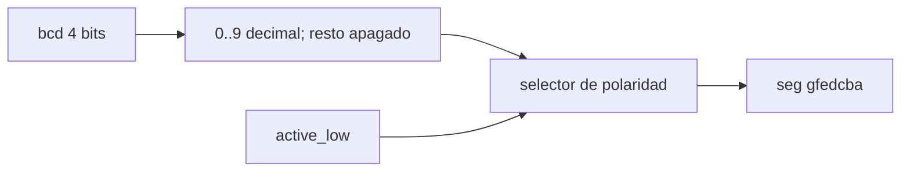

# bcd_to_7seg — decodificador decimal de siete segmentos

## Revisions

| Fecha | Cambio |
|---|---|
| 2026-10-16 | Segundo bloque de la familia I/O, E1/OE2 vigente. |

## Document Conventions

`seg[6:0]={g,f,e,d,c,b,a}`. Segmento `a` es la barra superior, `g` la central.
`active_low=1`: cero enciende el segmento. `active_low=0`: uno lo enciende.
No incluye punto decimal.

## Introduction

Decodificador **BCD**, no hexadecimal, para un dígito.
Complementa [`bin2bcd`](bin2bcd.md) dentro de la familia I/O de E1 (§V3),
criterio OE2 (§V4). Se reutiliza la convención de orden de segmentos de
`template/quartus/boards/seg7_hex.sv`, pero **no su contrato para A–F**.
El decodificador hexadecimal previo sigue intacto para sus wrappers.

## Block Diagram



## Configuration

Sin parámetros. `bcd[3:0]`, `active_low` son entradas; `seg[6:0]` salida.
La polaridad es una entrada combinacional, no una elección oculta de placa.
En DE1-SoC puede conectarse a `1'b1`; síntesis elimina el selector constante.
No se agregan pines de placa ni un wrapper nuevo.

## Protocols

| bcd | seg activo bajo (hex) | Símbolo |
|---|---|---|
| 0 | 40 | 0 |
| 1 | 79 | 1 |
| 2 | 24 | 2 |
| 3 | 30 | 3 |
| 4 | 19 | 4 |
| 5 | 12 | 5 |
| 6 | 02 | 6 |
| 7 | 78 | 7 |
| 8 | 00 | 8 |
| 9 | 10 | 9 |
| 10..15 | 7F | Todos apagados |

Activo alto es el complemento bit a bit de esos siete bits.
Un BCD inválido se **apaga**, no muestra letras ni representa un error
latcheado. No hay validación temporal ni supresión automática de ceros.
`default` cubre entradas no enumeradas en simulación de cuatro estados,
pero no se reclama una garantía física sobre valores X/Z.

## Memory Map

No aplica.

## Registers

No aplica: bloque puramente combinacional.

## Clock Domains

Sin reloj. Entradas conectadas desde el dominio del integrador.
No garantiza ausencia de transitorios al cambiar múltiples bits.

## Reset Domains

No aplica: no hay reset. Para apagar explícitamente, conducir un valor
inválido 10..15 o añadir gating en el integrador.

## Interrupts

No aplica.

## Arbitration

No aplica: un dígito, sin multiplexado de displays.

## Debugging

Comprobar primero orden `gfedcba` y polaridad. Si aparecen letras con
10..15 se está usando el decoder hexadecimal, no este módulo.

## Synthesis

```sh
make synth DESIGN=bcd_to_7seg
make netlist DESIGN=bcd_to_7seg
```

No se aplica WIDTH. Síntesis lógica Cyclone V con Yosys, sin dependencia
del decoder de placa. Timing, SDC y pines pertenecen a la integración
Quartus todavía no validada.

## Verification

```sh
python -m pytest tests/bcd_to_7seg -m "not simulation" -v
make sim DESIGN=bcd_to_7seg SIM=verilator
make sim DESIGN=bcd_to_7seg SIM=icarus
```

Los 16 valores × dos polaridades se prueban exhaustivamente, seguidos de
las mismas combinaciones en orden pseudoaleatorio (`TB_SEED=1234`).
El modelo usa conjuntos de letras de segmentos; el RTL una tabla binaria.
Python también comprueba patrones numéricos conocidos y que los inválidos
se apagan. El checker recibe valores enteros, no interfaces de simulador.

Validación local 2026-10-16: 20 pruebas Python y 2 simulaciones PASS
(CocoTB 1.9.2, Verilator 5.052 e Icarus 13.0); mapeo Yosys 0.66 y SVG
generados. No acredita reproducibilidad 1:1 con la imagen fijada.
No se ha probado el display físico ni JTAG.

## Microarchitecture

Tabla combinacional de diez entradas con valor `default=0` para segmentos
encendidos, seguida de inversión opcional. Todas las rutas asignan `lit`.

**Objeción:** ya existe `seg7_hex`.
**Respuesta:** comparte el pinout lógico, pero no la semántica decimal:
mostrar A–F ocultaría una entrada BCD inválida. Mantener el decoder pequeño
separado conserva los wrappers previos y permite verificar las 32
combinaciones sin imponer dependencias de placa.

## References

- Anteproyecto, adenda vigente §§V3–V4.
- RTL: `template/lib/bcd_to_7seg/bcd_to_7seg.sv`.
- Pruebas: `template/tests/bcd_to_7seg/`.
- Prior art: `template/quartus/boards/seg7_hex.sv` (contrato hexadecimal distinto).
- [OpenCE RTL Hardware Documentation Template](https://opencehardware.github.io/RTL-Hardware-Documentation-Template/).
