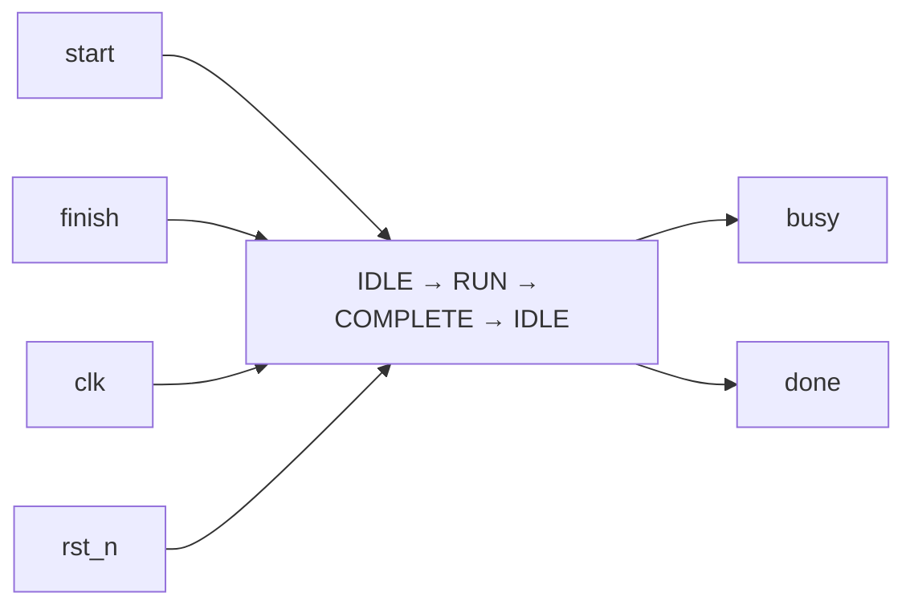

# control_fsm — control start/busy/done

## Revisions

| Fecha | Cambio |
|---|---|
| 2026-10-16 | Primera referencia de la familia FSM; E1/OE2 vigente. |

## Document Conventions

Valores de salidas después del flanco ascendente, una vez estabilizada la lógica.
`rst_n` es activo bajo. No se asumen pulsos para `start` ni `finish`.

## Introduction

Controlador Moore mínimo para una operación cuya duración decide el integrador.
No contiene datapath, contador de duración, MMIO ni sistema demo.
Implementa la familia FSM de la adenda del anteproyecto (§V3), criterio OE2 (§V4).

## Block Diagram



## Configuration

Sin parámetros. Entradas: `clk`, `rst_n`, `start`, `finish` de un bit.
Salidas: `busy`, `done` de un bit. Todas las entradas de control deben
pertenecer al dominio `clk`.

## Protocols

| Estado antes del flanco | Condición | Estado después | busy, done después |
|---|---|---|---|
| Cualquiera | `rst_n=0` | IDLE | 0, 0 |
| IDLE | `start=0` | IDLE | 0, 0 |
| IDLE | `start=1` | RUN | 1, 0 |
| RUN | `finish=0` | RUN | 1, 0 |
| RUN | `finish=1` | COMPLETE | 0, 1 |
| COMPLETE | Siempre | IDLE | 0, 0 |

`finish` en IDLE se ignora, incluso simultáneo a `start`: no existe operación
de cero ciclos. `start` en RUN o COMPLETE se ignora, no se encola.
`done` dura exactamente un ciclo salvo reset. Hay un ciclo IDLE de retorno
antes de aceptar otra operación. Un `start` sostenido **sí vuelve a disparar**
cuando se alcanza IDLE: no es detector de flanco. Si `finish` nunca llega,
`busy` permanece alto hasta reset. No existe timeout implícito.

## Memory Map

No aplica: no se implementa un bus ni MMIO.

## Registers

Registro interno `state` de dos bits; codificación no forma parte de la interfaz.
La síntesis puede recodificarlo. `next_state` es combinacional.

## Clock Domains

Un único reloj. El testbench usa 20 ns (50 MHz), no acredita cierre temporal.
Para una entrada externa de un bit, el integrador puede emplear
[`sync_2ff`](sync_2ff.md). Sincronizar **no elimina rebotes** ni garantiza capturar
pulsos cortos. No se sincronizan buses bit a bit.

## Reset Domains

Aserción asíncrona activa baja; liberar `rst_n` sincronizado con `clk`.
Reset aborta RUN y elimina un `done` activo sin producir una finalización nueva.
El módulo no incluye circuito de liberación del reset.

## Interrupts

No aplica. `done` es un pulso síncrono; no es una interrupción retenida.

## Arbitration

No aplica: un solicitante; peticiones durante ocupación no se almacenan.

## Debugging

Observar `start`, `finish`, `busy`, `done`, `rst_n` y `clk` en la onda.
`busy` y `done` jamás deben coincidir en el contrato digital.
Un `busy` indefinido puede ser una operación sin `finish`, no necesariamente
un fallo del controlador.

## Synthesis

Desde `template/`:

```sh
make synth DESIGN=control_fsm
make netlist DESIGN=control_fsm
```

Se selecciona exclusivamente el top de biblioteca, sin wrappers de placa.
No se aplica `chparam WIDTH` a este módulo sin parámetros.
Yosys valida síntesis lógica Cyclone V; Quartus, SDC, STA e implementación
física permanecen pendientes para el sistema que lo integre.

## Verification

```sh
python -m pytest tests/control_fsm -m "not simulation" -v
make sim DESIGN=control_fsm SIM=verilator
make sim DESIGN=control_fsm SIM=icarus
```

`model.py` describe la transacción sin depender de la codificación del RTL.
`stimulus.py` ejercita finalizaciones ignoradas, start sostenido, espera,
retorno a IDLE y reset en RUN/COMPLETE, seguido de aleatorización con
`TB_SEED=1234` y `TB_CYCLES=500` por defecto. `checker.py` compara salidas y
rechaza solapamiento. `tb_control_fsm.py` es el único driver CocoTB.
Reset se comprueba entre flancos además de en el flanco de muestreo.

Validación local 2026-10-16: 8 pruebas Python y 2 simulaciones PASS
(CocoTB 1.9.2, Verilator 5.052 e Icarus 13.0); mapeo Yosys 0.66 y SVG
generados. Estas versiones locales no acreditan la reproducibilidad 1:1
de la imagen fijada. Los checks negativos del checker no equivalen a una
campaña de mutación RTL. No hay prueba en FPGA ni ausencia total de bugs.

## Microarchitecture

Un `always_ff` para estado y un `always_comb` con valor por defecto para la
transición; no hay latches intencionales. Decodificación Moore de las salidas.
Un estado digital no reconocido retorna a IDLE; esto no constituye
tolerancia a fallos físicos ni recuperación certificada de SEU.

**Objeción:** la burbuja de retorno reduce throughput.
**Respuesta:** es un contrato de control didáctico simple, no un pipeline de
datos. Una FSM que acepte solicitudes en COMPLETE cambiaría el protocolo;
no se introduce esa complejidad sin requisito del demo. La tabla y pruebas
dirigidas permiten verificar ese coste explícito.

## References

- Anteproyecto, adenda vigente §§V2–V4.
- RTL: `template/lib/control_fsm/control_fsm.sv`.
- Pruebas: `template/tests/control_fsm/`.
- [OpenCE RTL Hardware Documentation Template](https://opencehardware.github.io/RTL-Hardware-Documentation-Template/).
