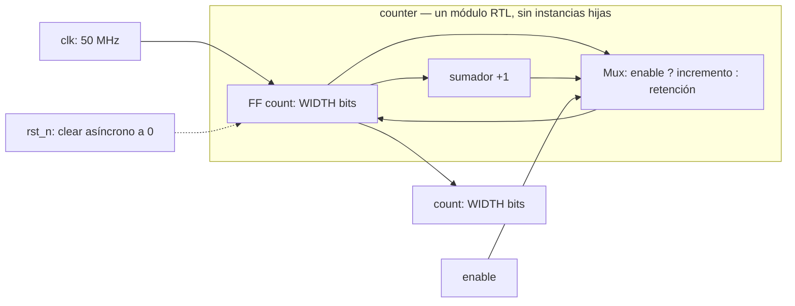

# Módulo: `counter`

> Documentación del módulo RTL siguiendo la estructura del
> [OpenCE Hardware RTL Documentation Template](https://opencehardware.github.io/RTL-Hardware-Documentation-Template/).
> Fuente RTL: `template/src/counter.sv`. Testbench: `template/tests/counter/`.

Este documento cubre **todas** las secciones que exige el template. Cuando una
sección no aplica al diseño, se indica explícitamente "No aplica" y el motivo;
nunca se omite ni se deja en blanco, siguiendo la recomendación propia del
template para diseños simples.

**Alcance declarado:** `counter` es un diseño de humo ("smoke design"), cuyo
único propósito es probar que la cadena de herramientas está viva (Verilator
y Icarus construyen, CocoTB estimula, PyTest reporta, el gatekeeper se pone en
verde). El propio código fuente lo etiqueta explícitamente como "NOT the
pattern for lib/ modules"; no es, ni pretende ser, un módulo de biblioteca
reutilizable. Esta ficha documenta lo que existe (una interfaz RTL simple,
sin bus, sin registros mapeados en memoria, sin protocolo de transacciones),
sin inventar arquitectura, protocolos o registros que el diseño no tiene.

---

## Revisions

| Versión | Fecha | Cambio | Autor |
|---|---|---|---|
| 1.0 | 2026-08-31 | Primera versión de la ficha, alineada con `counter.sv` y su testbench CocoTB. | Proyecto TFG |
| 1.1 | 2026-10-05 | Esquema Mermaid, contrato de reset corregido y matriz de anchos elaborados. | Proyecto TFG |

---

## Document Conventions

| Término | Significado |
|---|---|
| DUT | Device Under Test: el módulo `counter` bajo prueba. |
| WIDTH | Parámetro de ancho del contador, en bits. |
| Smoke design | Diseño trivial cuyo único propósito es validar que la cadena de herramientas (build + simulación + reporte) funciona de extremo a extremo. |
| Activo-bajo | Señal cuya condición se cumple en nivel lógico 0 (aplica a `rst_n`). |

Convenciones de nomenclatura: señales de entrada/salida en minúsculas con
guion bajo; `_n` como sufijo de señales activo-bajas; parámetros en
`UPPER_CASE`.

---

## Introduction

`counter` es un contador ascendente síncrono de `WIDTH` bits (parámetro,
default 8), con reset asíncrono activo bajo y una entrada de habilitación
(`enable`) síncrona. No implementa detención en el valor máximo: al llegar a
`2^WIDTH - 1` da la vuelta (*wraps*) a 0 en el siguiente ciclo habilitado.

**Propósito en el proyecto:** validar que Verilator 5.028 e Icarus Verilog
12.0 (los dos simuladores open-source del toolchain) puedan construir y
simular el mismo RTL con idéntico resultado, y que el mismo testbench CocoTB
corra igual en ambos, tanto localmente (Docker) como en el clúster HPC
Kabré (Apptainer + SLURM). No es una IP destinada a integrarse en un sistema
mayor.

**Features:**

- Contador binario ascendente, ancho parametrizable (`WIDTH`, `int unsigned`, default 8).
- Reset asíncrono activo bajo (`rst_n`).
- Habilitación síncrona (`enable`); sin `enable`, el contador retiene su valor.
- Wrap-around modulo `2^WIDTH` (sin bandera de overflow).
- Sin interfaz de bus, sin interrupciones, sin dependencias externas.

---

## Block Diagram

```
        ┌─────────────────────────────┐
 clk ──►│                             │
rst_n──►│         counter             ├──► count[WIDTH-1:0]
enable─►│  (registro + sumador +1)    │
        └─────────────────────────────┘
```

Microarquitectura interna: un único registro de `WIDTH` bits (`count`)
realimentado a través de un sumador `+1`, con selección de retención
(`enable=0`) y clear asíncrono del registro. No hay sub-bloques ni jerarquía adicional; ver
sección *Microarchitecture* más abajo.

**Esquema conceptual RTL (no netlist sintetizada ni circuito físico):**



La frontera encierra lógica del único `always_ff`; los nodos no representan
submódulos instanciados. Todos los puertos RTL aparecen en el esquema.

---

## Configuration

### Parámetros

| Parámetro | Tipo | Default | Rango válido | Descripción |
|---|---|---|---|---|
| `WIDTH` | `int unsigned` | `8` | `WIDTH >= 1` (no validado en RTL; `WIDTH=0` produce un vector de rango inválido dependiente de la herramienta; **precondición del usuario, no verificada en tiempo de elaboración**) | Ancho en bits del contador y de `count`. |

### Puertos / interfaz RTL

| Señal | Dirección | Ancho | Descripción |
|---|---|---|---|
| `clk` | input | 1 | Reloj del sistema, flanco de subida. |
| `rst_n` | input | 1 | Reset asíncrono, activo bajo. |
| `enable` | input | 1 | Habilitación síncrona de conteo. |
| `count` | output | `WIDTH` | Valor actual del contador. |

No hay typedefs, structs empaquetados, ni interfaces SystemVerilog (`interface`);
la conexión es por puertos planos.

---

## Protocols

**No aplica.** El módulo no implementa ningún protocolo de transacción
(handshake, válido/listo, streaming, etc.). `enable` es una señal de control
directa muestreada en cada flanco de reloj, no un protocolo de comunicación.

---

## Memory Map

**No aplica.** El módulo no expone ningún bus direccionable ni espacio de
memoria mapeado; es lógica secuencial pura con puertos directos.

---

## Registers

**No aplica en el sentido de "registros programables por software".** El
único elemento de estado es `count`, un registro de hardware observable por
la salida del mismo nombre, no un registro accesible vía un bus de
configuración. No hay registros de control, estado ni máscara de
interrupciones.

---

## Clock Domains

Un único dominio de reloj: `clk`. Todo el diseño (el único registro `count`)
es síncrono a este reloj. No hay cruces de dominio de reloj (CDC) que
gestionar.

---

## Reset Domains

Un único dominio de reset: `rst_n`, asíncrono y activo bajo.
**La sintaxis `always_ff @(posedge clk or negedge rst_n)` no sincroniza la
liberación del reset.** El integrador debe suministrar deassert sincronizado
al dominio `clk` y cumplir recovery/removal. No hay sincronizador de reset
dentro del contador ni reset por software.

---

## Interrupts

**No aplica.** El módulo no genera ni consume interrupciones.

---

## Arbitration

**No aplica.** No hay recursos compartidos entre múltiples maestros; `count`
tiene un único escritor (el propio registro) y ninguna disputa de acceso que
arbitrar.

---

## Debugging

Puntos de observación recomendados en simulación (forma de onda VCD/FST):

- `count`: valor del contador en cada ciclo.
- `enable`: para correlacionar los ciclos en que el contador efectivamente
  incrementa vs. retiene.
- `rst_n`: para verificar la ventana exacta de reset.

No hay lógica de debug embebida (no hay señales de trace, ILA, ni puertos de
depuración); el diseño es demasiado simple para justificarla, y el propio
alcance del módulo (smoke design) no lo requiere.

---

## Synthesis

La síntesis lógica abierta se ejecuta con Yosys 0.40 mediante
`synth_intel_alm -family cyclonev`. `make synth DESIGN=counter WIDTH=8`
elabora el RTL, aplica `check -assert`, genera una red JSON y confirma el
mapeo a celdas `MISTRAL_*`.

Esta comprobación no sustituye place-and-route, bitstream ni timing. El
`artifact-gate` de Quartus permanece deshabilitado hasta disponer de un
reporte físico real ligado al commit. El objetivo temporal único es 50 MHz,
definido por el SDC seleccionado mediante `TARGET_BOARD` en
`template/quartus/targets/`.

---

## Verification

**Metodología:** CocoTB + modelo de referencia en Python + PyTest como
runner y agregador de resultados.

**Componentes del testbench** (`template/tests/counter/`):

| Archivo | Rol |
|---|---|
| `model.py` | Modelo de referencia en Python puro (sin RTL) del comportamiento esperado del contador. |
| `stimulus.py` | Generador de secuencias de `enable` reproducibles por semilla (`enable_sequence`). |
| `checker.py` | Comparador ciclo a ciclo entre el DUT y el modelo de referencia; reporta discrepancias con su ciclo exacto. |
| `tb_counter.py` | Testbench CocoTB: `test_reset_clears_the_count`, `test_counts_against_reference_model`, `test_wraps_at_the_parameterised_width`. |
| `test_counter.py` | Capa PyTest: pruebas unitarias del modelo/checker sin simulador, más la invocación de la simulación vía `make sim`. |

**Simuladores verificados, con evidencia real de ejecución (no solo local):**

| Simulador | Local (Docker Desktop) | Kabré (SLURM real) |
|---|---|---|
| Verilator 5.028 | 61 passed / 11 skipped (`make test`) | Job `608383` (`sbatch hpc/regression.slurm`, partición `kura-wide`, nodo `kura-1c.cnca`): `COMPLETED`, 61 passed / 11 skipped, 34 s de ejecución. |
| Icarus Verilog 12.0 | 3/3 PASS (`make sim SIM=icarus DESIGN=counter`) | Job `608384` (`srun`, partición `kura-debug`, nodo `kura-1c.cnca`): `COMPLETED`, 3/3 PASS (`test_reset_clears_the_count`, `test_counts_against_reference_model`, `test_wraps_at_the_parameterised_width`). |

**Cobertura funcional cubierta por los tres tests CocoTB:**

1. El reset asíncrono lleva `count` a 0 sin importar el estado previo.
2. Una secuencia aleatoria (semilla fija, reproducible) de `enable` produce el
   mismo valor que el modelo de referencia, ciclo a ciclo.
3. El contador da la vuelta módulo `2^WIDTH`, no satura.

**Actualización 2026-10-05:** `sim.mk` aplica `WIDTH` al elaborador y el
testbench verifica el ancho real. La matriz añadida cubre Verilator con
1/4/8 bits e Icarus con 4 bits. El recorrido exhaustivo de wrap se limita a
`WIDTH<=16` para que la demostración tenga duración acotada; esto limita el
test de wrap, no el parámetro RTL.

```bash
make sim DESIGN=counter WIDTH=4
make sim DESIGN=counter WIDTH=4 SIM=icarus
make library-test
make library-regression
make netlist DESIGN=counter WIDTH=8
```

La corrida final del 2026-10-05 sí ejecutó la matriz nueva:
`make library-regression RESULTS_DIR=/evidence/final`, desde una copia estable
en `digital-design-verify:demo` (imagen `321e6b8abeb5`), produjo **71 passed,
0 skipped**, incluyendo 19 invocaciones RTL de la biblioteca completa
(Verilator 5.028 / Icarus 12.0). Evidencia:
`template/results/demo-library-1005/final/junit-library.xml` y `library.html`.
El intento inicial fallido se conserva separado: incluyó una lectura durante
edición de `sim.mk` y un literal de parámetro sin ancho, ambos resueltos antes
de la corrida final. No se añade evidencia física ni JTAG.

`make synth-all` validó nueve configuraciones con Yosys 0.40.
`make netlist-all` produjo seis DOT pre-mapping en ese directorio de resultados.
La imagen `:demo` no traía Graphviz. La comprobación posterior con
`:full-demo` (`c989ca3e1c32`, Graphviz 2.43.0) completó `netlist-all`:
seis DOT y seis SVG no vacíos en
`template/results/demo-library-1005/full-demo-netlists/`.
Mermaid sigue siendo la vista conceptual para redibujar; SVG es pre-mapping,
no un circuito físico.

---

### Test Environment

| Herramienta | Versión observada | Configuración de la corrida final |
|---|---|---|
| Imagen Docker | `digital-design-verify:demo`, `321e6b8abeb5` | Copia estable Linux en `/tmp/library`, sin cachés previas. |
| Python / PyTest | 3.10.12 / 8.3.4 | Modelo, estímulo y checker separados del driver CocoTB. |
| Verilator | 5.028 | WIDTH=1,4,8; `TB_SEED=1234`, `TB_CYCLES=500`; reloj 20 ns. |
| Icarus | 12.0 | WIDTH=4, misma semilla y contrato. |
| Yosys | 0.40 | Cyclone V, WIDTH=8; síntesis lógica independiente. |

### Tests and Results

| Tipo | Resultado observado | Evidencia |
|---|---|---|
| Unitarias Python | 13/13 PASS | Clase `tests.counter.test_counter` del JUnit final. |
| Integración CocoTB | 4/4 invocaciones PASS; reset, conteo y wrap en cada una | Mismo JUnit: **17/17** pruebas del módulo, no 71 del módulo. |
| Verificación formal | N/A: no ejecutada | No se atribuyen resultados formales. |

### Benchmarks

| Métrica | Resultado / límite |
|---|---|
| Conteo funcional | Un incremento por ciclo habilitado; retención sin enable; comprobado digitalmente. |
| Tiempo de regresión | 159.21 s para toda la biblioteca; no es latencia del contador ni benchmark aislado. |
| Fmax, slack a 50 MHz, potencia y latencia física | **No medidos** en esta entrega de biblioteca. 50 MHz es el estímulo/objetivo, no timing demostrado. |

### Issues and Resolutions

| Problema | Resolución |
|---|---|
| WIDTH no alcanzaba el elaborador | Flags de parámetro y comparación del ancho real en el testbench. |
| Lectura de `sim.mk` durante edición en primera corrida | Copia estable; se conserva el intento fallido y se distingue la corrida final. |
| Texto afirmaba liberación de reset implícitamente sincronizada | Corregido: sincronización externa requerida. |

### Verification Summary

Contrato digital verificado en las cuatro configuraciones indicadas; síntesis
lógica WIDTH=8 aprobada. No acredita implementación física, reúso JTAG ni
kill rate RTL. Resultados actuales en `demo-library-1005/final/`; los resultados
históricos de Kabré anteriores no sustituyen esta evidencia.

## Microarchitecture


Diseño de un único bloque, sin sub-módulos:

### Sub-módulo único: registro contador

- Un registro de `WIDTH` bits (`count`).
- Lógica combinacional: sumador `+1` sobre el valor actual.
- Selección de retención (`enable=0`) o incremento (`enable=1`).
  El reset tiene prioridad mediante clear asíncrono, no es una tercera entrada
  síncrona de ese multiplexor.

No hay jerarquía adicional que documentar; el módulo completo es esta única
unidad secuencial.

---

## References

- RTL: `template/src/counter.sv`
- Testbench: `template/tests/counter/`
- Reglas de ejecución en Kabré: `docs/fase1/kabre.md`
- Guía de demostración de entregables (evidencia de ejecución real):
  `docs/fase1/demo-entregables-s4.md`
- Template de documentación seguido: [OpenCE Hardware RTL Documentation
  Template](https://opencehardware.github.io/RTL-Hardware-Documentation-Template/)
