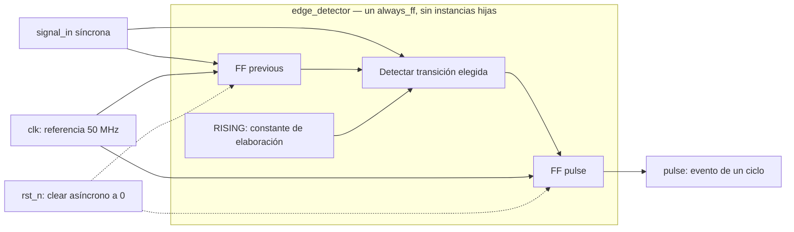

# Módulo: `edge_detector`

Ficha adaptada al [OpenCE RTL Hardware Documentation Template](https://opencehardware.github.io/RTL-Hardware-Documentation-Template/).
RTL: `template/lib/edge_detector/edge_detector.sv`; pruebas:
`template/tests/edge_detector/`.

## Revisions

| Versión | Fecha | Cambio |
|---|---|---|
| 1.0 | 2026-10-05 | Detector registrado parametrizable en polaridad, pruebas y esquema. |

## Document Conventions

`RISING=1`: subida; `RISING=0`: bajada. `_n`: activo bajo. Una muestra es el
valor estable en el flanco positivo de `clk`. «Pulso» significa una salida
registrada de un periodo del reloj, no una interrupción persistente.

## Introduction

Detector de transiciones entre muestras consecutivas de una señal
**ya síncrona**. Produce un evento de un ciclo en la polaridad elegida.
No es un sincronizador, filtro antirrebote ni capturador de pulsos
asíncronos. Para entradas externas se antepone un sincronizador de nivel;
ello no garantiza recuperar pulsos demasiado breves.

Forma parte de la biblioteca de cinco bloques de ADR-0007, incluida su adenda;
su contrato y pruebas apoyan cobertura de biblioteca OE3 (Tabla 1).

## Block Diagram

**Esquema conceptual RTL, no red sintetizada ni circuito físico.**



Los cuatro puertos reales cruzan la frontera. `RISING` es un parámetro, no
un puerto; los nodos internos representan registros y expresiones del
`always_ff`, no instancias de submódulos.

## Configuration

| Parámetro | Tipo | Default | Valores |
|---|---|---:|---|
| `RISING` | `bit` | 1 | 1 detecta subida, 0 bajada. |

No existe parámetro `WIDTH`; entrada y salida son de un bit.
No hay typedefs ni interfaz SystemVerilog.

| Puerto | Dirección | Ancho | Contrato |
|---|---|---:|---|
| `clk` | entrada | 1 | Captura en flanco positivo. |
| `rst_n` | entrada | 1 | Reset asíncrono, activo bajo. |
| `signal_in` | entrada | 1 | Señal estable respecto a `clk`. |
| `pulse` | salida | 1 | Evento registrado en el flanco que detecta la transición. |

## Protocols

No hay handshake ni backpressure. El consumidor debe muestrear cada ciclo.
Una transición seleccionada produce `pulse=1` después de la captura; si la
entrada permanece constante, la siguiente captura devuelve `pulse=0`.
El bloque compara muestras, no cambios ocurridos entre ellas.

## Memory Map

**No aplica:** no existe bus ni memoria direccionable.

## Registers

Sin registros de software. Estado de hardware:

| Registro | Ancho | Reset | Función |
|---|---:|---:|---|
| `previous` | 1 | 0 | Muestra del ciclo anterior. |
| `pulse` | 1 | 0 | Evento calculado con la nueva muestra y la anterior. |

## Clock Domains

Un dominio `clk`, con objetivo de referencia 50 MHz / 20 ns.
`signal_in` y el consumidor deben pertenecer a ese dominio. Una conexión
directa desde otro dominio viola el contrato; usar antes `sync_2ff` para un
nivel de un bit, no para prometer captura de todo pulso.

## Reset Domains

`rst_n=0` borra asíncronamente ambos registros. La liberación se sincroniza
**externamente**; `always_ff` no implementa esa sincronización.
La historia inicial es cero: si `signal_in=1` en la primera captura tras
reset, se emite un pulso en modo subida. En modo bajada primero debe haberse
muestreado un uno y luego un cero. Este comportamiento es intencional.

## Interrupts

**No aplica:** `pulse` no es una interrupción sticky, no tiene acknowledge ni
máscara. Convertirlo en interrupción pertenece al integrador.

## Arbitration

**No aplica:** no hay solicitudes simultáneas ni recursos compartidos.

## Debugging

Observar `signal_in`, `previous`, `pulse`, `rst_n`. Revisar la polaridad
elaborada y la historia tras reset. Si los eventos se pierden, verificar
primero la frecuencia y el dominio de muestreo; no asumir un fallo del checker.

## Synthesis

```bash
make synth DESIGN=edge_detector RISING=1
make synth DESIGN=edge_detector RISING=0
make netlist DESIGN=edge_detector RISING=1
make netlist DESIGN=edge_detector RISING=0
make synth-all
make netlist-all
```

Desde `template/`, con Yosys/Graphviz en el entorno abierto. Los artefactos
separan polaridad: `yosys-edge_detector-w1-r0.json`,
`yosys-edge_detector-w1-r1.json`, `netlist-edge_detector-w1-r0.svg` y
`netlist-edge_detector-w1-r1.svg`. El parámetro se resuelve en elaboración,
no es un puerto de control.

Yosys demuestra síntesis lógica para Cyclone V, no timing físico.
Quartus y su Timing Analyzer siguen siendo necesarios para P&R, bitstream y
margen a 50 MHz. No se afirma validación física del bloque.

## Verification

`stimulus.py`, `model.py`, `checker.py` son Python puro; únicamente
`tb_edge_detector.py` accede al DUT por CocoTB, según ADR-0002.

```bash
make sim DESIGN=edge_detector RISING=1 TB_SEED=1234
make sim DESIGN=edge_detector RISING=0 SIM=icarus
make library-test
make library-regression
```

La matriz PyTest usa ambas polaridades con Verilator e Icarus. Cubre niveles
constantes, transiciones consecutivas, duración de un ciclo, reset durante
un pulso activo y entrada alta tras liberar reset.
Los checkers detectan observaciones con polaridad invertida, salida fija en
cero y seguimiento de nivel en lugar de evento. Esto demuestra capacidad de
detectar esos errores, **no mide una campaña de mutación RTL ≥80 %**.

Estado al 2026-10-05: la corrida final en `digital-design-verify:demo`
(`321e6b8abeb5`) produjo **71 passed, 0 skipped**, incluyendo las cuatro
combinaciones polaridad/simulador del detector (Verilator 5.028 / Icarus 12.0).
Evidencia: `template/results/demo-library-1005/final/junit-library.xml`.
El primer intento detectó que Verilator rechazaba `-GRISING=1` por truncar
un entero de 32 bits: `sim.mk` ahora pasa el literal explícito `1'b1`/`1'b0`,
sin ocultar advertencias. La corrida final usó una copia estable.

Yosys 0.40 validó ambas polaridades, dentro de nueve configuraciones de
`synth-all`. `netlist-all` produjo inicialmente seis DOT en `:demo`.
Con `:full-demo` (`c989ca3e1c32`, Graphviz 2.43.0), la comprobación
posterior generó también seis SVG no vacíos en
`template/results/demo-library-1005/full-demo-netlists/`.
No hay acceso FPGA ni comparación JTAG.
Reutilización potencial de checker no equivale a fracción de reúso medida.

### Test Environment

| Herramienta | Versión observada | Configuración |
|---|---|---|
| Imagen Docker | `digital-design-verify:demo`, `321e6b8abeb5` | Copia Linux estable en `/tmp/library`, sin cachés previas. |
| Python / PyTest | 3.10.12 / 8.3.4 | Modelo de muestras y checker puro; driver CocoTB. |
| Verilator / Icarus | 5.028 / 12.0 | RISING=0,1 en ambos; reloj 20 ns, `TB_SEED=1234`, `TB_CYCLES=500`. |
| Yosys | 0.40 | Cyclone V, ambas polaridades, sin WIDTH. |

### Tests and Results

| Tipo | Resultado observado | Evidencia |
|---|---|---|
| Unitarias Python | 12/12 PASS: polaridad, reset, semilla y errores inyectados | Clase `tests.edge_detector.test_edge_detector`. |
| Integración CocoTB | 4/4 invocaciones PASS: polaridades, duración y reset | **16/16** pruebas del módulo en `final/junit-library.xml`. |
| Verificación formal | N/A: no ejecutada | No se afirma equivalencia formal ni cobertura exhaustiva. |

### Benchmarks

| Métrica | Resultado / límite |
|---|---|
| Duración del evento | Un periodo de reloj en simulación (20 ns con este estímulo), para cada transición seleccionada. |
| Instante funcional | `pulse` se actualiza tras el flanco que captura la transición; no espera otra captura. |
| Fmax, slack, clock-to-Q, potencia físicos | **No medidos**. El periodo simulado no prueba implementación a 50 MHz. |
| Tiempo de suite | 159.21 s para toda la biblioteca, no benchmark del detector. |

### Issues and Resolutions

| Problema | Resolución |
|---|---|
| Verilator rechazaba `RISING=1` sin ancho explícito | Literal `1'b1`/`1'b0`; advertencias permanecen habilitadas. |
| Reporte no reconocía sufijos `-r0/-r1` | Parser y prueba de regresión; variantes separadas y reporte estricto PASS. |
| Entrada alta al liberar reset podría parecer evento espurio | Contrato explícito: historia inicial cero; subida inicial se detecta. |

### Verification Summary

Cuatro configuraciones simuladas y dos síntesis lógicas aprobadas.
El bloque requiere entrada síncrona; no acredita captura de pulsos asíncronos,
validación física ni kill rate RTL.

## Microarchitecture

Para subida: `pulse[n] = signal_in[n] && !previous[n-1]`.
Para bajada: `pulse[n] = !signal_in[n] && previous[n-1]`.
En ambas: `previous[n] = signal_in[n]`.
Son asignaciones no bloqueantes: el evento compara la entrada actual con
la historia anterior y queda registrado, sin depender combinacionalmente de
la entrada después del flanco.

**Objeción:** añadir un registro al pulso cambia una detección combinacional.
**Respuesta:** el contrato define expresamente una salida registrada que se
actualiza al capturar la transición, evita glitches entre flancos y mantiene
un evento de ciclo completo. El test comprueba ese contrato, no uno inferido.

## References

- [OpenCE RTL Hardware Documentation Template](https://opencehardware.github.io/RTL-Hardware-Documentation-Template/)
- [Alcance y adenda](../decisions/ADR-0007-alcance-biblioteca-y-operacion.md)
- Anteproyecto: OE3 y Tabla 1
- [Sincronizador de nivel](sync_2ff.md)
- RTL: `template/lib/edge_detector/edge_detector.sv`
- Pruebas: `template/tests/edge_detector/`
