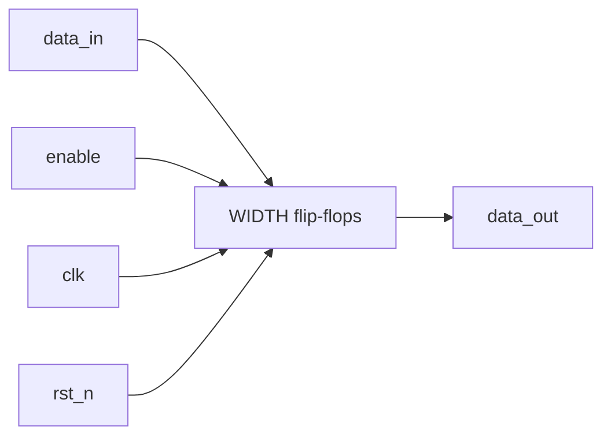

# enabled_register — registro con habilitación

## Revisions

| Fecha | Cambio |
|---|---|
| 2026-10-16 | Referencia de la familia registros, E1/OE2 vigente. |

## Document Conventions

Dato sin signo de `WIDTH` bits. Valores observados después del flanco
ascendente; reset tiene prioridad sobre enable.

## Introduction

Registro reutilizable con carga habilitada y reset a cero, sin interfaz de bus.
Implementa la familia registros de E1 (§V3 de la adenda), criterio OE2 (§V4).
No selecciona un sistema demo ni implementa MMIO.

## Block Diagram



## Configuration

| Nombre | Contrato |
|---|---|
| `WIDTH` | Entero ≥1, por defecto 8; `WIDTH=1` válido |
| `data_in`, `data_out` | Vectores de `WIDTH` bits |
| `clk`, `rst_n`, `enable` | Señales de un bit |

Un `WIDTH<1` se rechaza por `$fatal` en simulación/elaboración; el modelo
también lo rechaza. El dato Python fuera de `0..2**WIDTH-1` genera `ValueError`,
no un enmascaramiento silencioso. En el RTL el ancho de puerto es el contrato.
La matriz verificada cubre WIDTH 1, 8, 32 y 64, no todos los enteros.

## Protocols

| Condición | Resultado |
|---|---|
| `rst_n=0` | `data_out=0` inmediatamente, sin esperar reloj |
| Flanco ascendente, `rst_n=1`, `enable=1` | Captura `data_in` |
| Flanco ascendente, `rst_n=1`, `enable=0` | Conserva el dato anterior |

No hay latencia adicional ni bypass combinacional. Cambiar `data_in`
entre flancos no altera `data_out`. Enable sostenido carga cada ciclo.

## Memory Map

No aplica: no incluye decodificador de direcciones ni MMIO.

## Registers

Un banco `data_out[WIDTH-1:0]`, reset a cero. No hay máscara de bytes
ni valor de reset parametrizable.

## Clock Domains

Un dominio `clk`, pruebas a 50 MHz. `enable` y dato deben estar sincronizados.
No usar un sincronizador independiente por bit para transportar un bus.

## Reset Domains

Aserción asíncrona activa baja, liberación sincronizada externamente a `clk`.
El reset domina incluso cuando `enable=1` y `data_in` es el máximo.

## Interrupts

No aplica.

## Arbitration

No aplica: una fuente de escritura.

## Debugging

Comparar dato previo, enable y dato de entrada en cada flanco.
Un cambio con `enable=0` fuera de reset es divergencia.

## Synthesis

```sh
make synth DESIGN=enabled_register WIDTH=1
make synth DESIGN=enabled_register WIDTH=32
make netlist DESIGN=enabled_register WIDTH=8
```

`make synth-all` cubre WIDTH 1, 8 y 32. La implementación lógica puede usar
enable de flip-flop o mux según la tecnología. No se fija una cuenta de LUT.
No se acredita cierre temporal, P&R ni FPGA; Quartus y las restricciones del
integrador siguen siendo necesarios.

## Verification

```sh
python -m pytest tests/enabled_register -m "not simulation" -v
python -m pytest tests/enabled_register -m simulation -v
make sim DESIGN=enabled_register WIDTH=1 SIM=verilator
make sim DESIGN=enabled_register WIDTH=64 SIM=icarus
```

Modelo, estímulos y checker son Python puro; driver en
`tb_enabled_register.py`. Casos: máximo, cero, carga, retención, enable
sostenido, reset con enable 0/1 y aserción entre flancos. Casos dirigidos y
500 ciclos pseudoaleatorios, semilla `TB_SEED=1234` por defecto.
El driver verifica que WIDTH del RTL coincide con el del modelo.

Validación local 2026-10-16: 9 pruebas Python y 8 simulaciones PASS
(CocoTB 1.9.2, Verilator 5.052 e Icarus 13.0); mapeo Yosys 0.66 w1/w8/w32
y SVG w8 generados. No acredita reproducibilidad 1:1 con la imagen fijada.
Checks negativos del checker no son un *mutation kill rate* medido.

## Microarchitecture

Un `always_ff @(posedge clk or negedge rst_n)` con asignaciones no bloqueantes.
La rama sin enable conserva el estado: infiere almacenamiento de flanco,
no un latch. No hay combinaciones realimentadas fuera de la lógica de enable.

**Objeción:** sería más general un banco de registros con bus y máscaras.
**Respuesta:** no es necesario para demostrar carga/retención/reset y
añadiría semántica del demo todavía no decidida. El registro habilitado
estándar aporta una referencia acotada con pruebas exhaustivas de sus
decisiones de control y parametrización representativa.

## References

- Anteproyecto, adenda vigente §§V3–V4.
- RTL: `template/lib/enabled_register/enabled_register.sv`.
- Pruebas: `template/tests/enabled_register/`.
- [OpenCE RTL Hardware Documentation Template](https://opencehardware.github.io/RTL-Hardware-Documentation-Template/).
