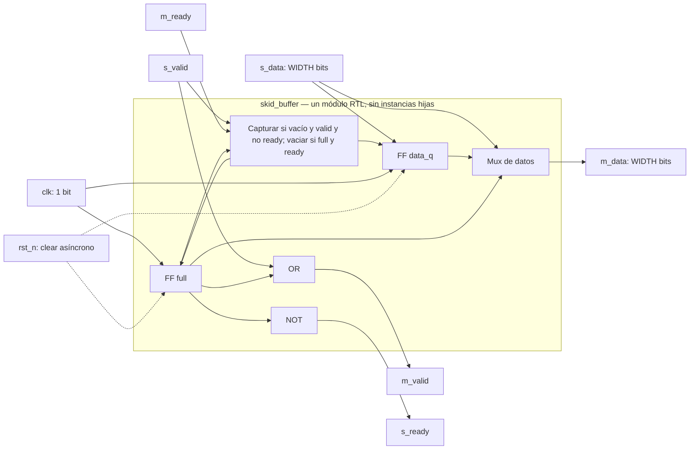

# Módulo: `skid_buffer`

> Documentación conforme al
> [OpenCE Hardware RTL Documentation Template](https://opencehardware.github.io/RTL-Hardware-Documentation-Template/).
> RTL: `template/lib/skid_buffer/skid_buffer.sv`.
> Verificación: `template/tests/skid_buffer/`.

## Revisions

| Versión | Fecha | Cambio |
|---|---|---|
| 1.0 | 2026-09-03 | Primera versión alineada con el RTL, las pruebas CocoTB/PyTest y la síntesis Yosys. |
| 1.1 | 2026-10-05 | Esquema Mermaid, bypass durante reset y comandos integrados. |

## Document Conventions

| Término | Significado |
|---|---|
| DUT | Módulo bajo prueba. |
| `WIDTH` | Ancho del dato en bits. |
| Fuente | Lado productor de la interfaz, prefijo `s_`. |
| Destino | Lado consumidor de la interfaz, prefijo `m_`. |
| Transferencia | Ciclo en que `valid` y `ready` tienen valor 1 simultáneamente. |
| Backpressure | Condición en la que el destino mantiene `m_ready=0`. |

Las señales activas en bajo usan el sufijo `_n`. Los parámetros se escriben en
mayúsculas. Los nombres `s_*` y `m_*` representan las interfaces de entrada y
salida, respectivamente.

## Introduction

`skid_buffer` es un buffer elástico de una entrada para un canal ready-valid.
Desacopla al productor del consumidor durante un ciclo de backpressure sin
perder ni reordenar datos. El módulo almacena una palabra cuando la entrada es
aceptada y la conserva hasta que el destino completa la transferencia.

Características:

- Ancho parametrizable mediante `WIDTH`, con valor predeterminado de 8 bits.
- Capacidad de una palabra.
- Throughput máximo de una palabra por ciclo.
- Latencia mínima de cero ciclos mediante bypass cuando no hay backpressure.
- Ruta `m_ready` a `s_ready` cortada mediante el estado registrado `full`.
- Retención estable de `m_valid` y `m_data` durante backpressure.
- Reset asíncrono activo bajo.

## Block Diagram

```text
                 +----------------------------------+
s_valid -------->|                                  |--------> m_valid
s_data[WIDTH-1:0]|  registro de datos + bit full    |--------> m_data[WIDTH-1:0]
s_ready <--------|                                  |<-------- m_ready
                 +----------------------------------+
                           ^          ^
                           |          |
                          clk       rst_n
```

El esquema anterior es una vista de interfaces. Esta vista de
microarquitectura es **conceptual RTL**, no netlist ni circuito físico:



`clk` captura `full`/`data_q`; `rst_n` los borra asíncronamente.
Los nodos de la frontera son lógica y registros del módulo, no instancias
de submódulos. El dibujo incluye los ocho puertos reales.

## Configuration

### Parámetros

| Parámetro | Tipo | Valor inicial | Rango válido | Descripción |
|---|---|---:|---|---|
| `WIDTH` | `int unsigned` | 8 | `WIDTH >= 1` | Ancho de `s_data`, `m_data` y del registro interno. |

`WIDTH=0` no es una configuración válida. La prueba y los comandos de
demostración cubren 1, 8 y 32 bits.

### Puertos

| Señal | Dirección | Ancho | Descripción |
|---|---|---:|---|
| `clk` | entrada | 1 | Reloj, flanco positivo. |
| `rst_n` | entrada | 1 | Reset asíncrono activo bajo. |
| `s_valid` | entrada | 1 | Indica que `s_data` contiene una palabra válida. |
| `s_ready` | salida | 1 | Indica que el módulo puede aceptar `s_data`. |
| `s_data` | entrada | `WIDTH` | Dato presentado por la fuente. |
| `m_valid` | salida | 1 | Indica que `m_data` contiene una palabra válida. |
| `m_ready` | entrada | 1 | Indica que el destino puede aceptar `m_data`. |
| `m_data` | salida | `WIDTH` | Dato presentado al destino. |

## Protocols

El módulo implementa un protocolo ready-valid sin señal de paquete.

Una entrada se acepta cuando:

```text
s_valid && s_ready
```

Una salida se consume cuando:

```text
m_valid && m_ready
```

Reglas:

1. La fuente debe mantener `s_valid` y `s_data` hasta que `s_ready` permita la
   transferencia.
2. El skid buffer mantiene `m_valid` y `m_data` estables mientras
   `m_ready=0`.
3. Cuando el buffer está vacío, `s_ready=1` y los datos pasan directamente a
   la salida.
4. Si el destino deja de estar listo, la palabra presentada se captura y
   `s_ready` baja hasta que la palabra almacenada sea consumida.
5. La ruta de backpressure `m_ready` a `s_ready` no es combinacional.
6. No hay señal de descarte, error ni fin de paquete.

## Memory Map

**No aplica.** El módulo no contiene una interfaz direccionable ni memoria
mapeada.

## Registers

**No aplica como mapa de registros de software.** La microarquitectura contiene:

| Registro interno | Ancho | Función |
|---|---:|---|
| `full` | 1 | Indica si hay una palabra válida almacenada. |
| `data_q` | `WIDTH` | Conserva la palabra pendiente. |

Estos registros no son accesibles mediante un bus de configuración.

## Clock Domains

Existe un único dominio, `clk`. Todos los elementos de estado se actualizan en
el flanco positivo. El proyecto usa `CLOCK_50` de la DE1-SoC como referencia,
con periodo SDC de 20 ns.

## Reset Domains

Existe un único reset, `rst_n`, asíncrono y activo bajo. Al activarlo:

- `full` pasa a 0.
- `data_q` pasa a 0.
- `m_valid=s_valid` durante reset, porque `full=0` conserva el bypass.
- `s_ready=1` y `m_data=s_data`. Reset **no enmascara las salidas**;
  el productor debe mantener `s_valid=0` durante reset si se quiere reposo.

La integración de nivel superior debe garantizar una liberación de reset
adecuada al dominio `clk`.
El propio `always_ff` no sincroniza la liberación.

## Interrupts

**No aplica.** El módulo no genera ni recibe interrupciones.

## Arbitration

**No aplica.** Existe una sola fuente y un solo destino. No hay múltiples
solicitantes ni selección de prioridad.

## Debugging

Las señales recomendadas para una forma de onda son:

- `s_valid`, `s_ready` y `s_data`.
- `m_valid`, `m_ready` y `m_data`.
- `full` y `data_q`, cuando la herramienta permite observar estado interno.
- `rst_n`.

Durante backpressure debe observarse `m_valid=1`, `m_ready=0` y `m_data`
estable. Un cambio de dato en esa condición indica una violación del
protocolo.

## Synthesis

La síntesis lógica abierta se ejecuta con Yosys 0.40:

```bash
make synth DESIGN=skid_buffer TOPLEVEL=skid_buffer WIDTH=8
```

El flujo usa:

```text
synth_intel_alm -family cyclonev
```

La comprobación elabora el parámetro, ejecuta `check -assert`, genera JSON y
confirma mapeo a celdas `MISTRAL_*`. `make synth-all` cubre anchos de 1, 8 y
32 bits.

Esta evidencia no representa place-and-route, Fmax, bitstream ni cumplimiento
de timing. Quartus y Timing Analyzer siguen siendo la autoridad para la
implementación física en la DE1-SoC. El objetivo temporal único es 50 MHz.
Todavía no se afirma una implementación física exitosa del skid buffer.

## Verification

La verificación usa una separación de cuatro piezas:

| Archivo | Responsabilidad |
|---|---|
| `stimulus.py` | Secuencias dirigidas y pseudoaleatorias con semilla. |
| `model.py` | Modelo de referencia ciclo a ciclo. |
| `checker.py` | Comparación de observaciones esperadas y reales. |
| `tb_skid_buffer.py` | Control de reloj, reset y puertos mediante CocoTB. |

`test_skid_buffer.py` agrega pruebas unitarias y lanza las simulaciones desde
PyTest. La cobertura incluye:

1. Llenado y vaciado.
2. Backpressure durante varios ciclos.
3. Estabilidad del dato de salida mientras el destino no está listo.
4. Liberación del buffer y reanudación del bypass.
5. Transferencias consecutivas de una palabra por ciclo en modo bypass.
6. Secuencias pseudoaleatorias reproducibles.
7. Anchos de 1 y 8 bits con Verilator.
8. Ancho de 32 bits con Icarus.
9. Síntesis Yosys para anchos de 1, 8 y 32 bits mediante `make synth-all`,
   fuera del directorio del testbench.
10. Detección de una divergencia inyectada en el comprobador.

Comandos principales:

```bash
make sim DESIGN=skid_buffer WIDTH=8
make sim SIM=icarus DESIGN=skid_buffer WIDTH=32
make synth DESIGN=skid_buffer WIDTH=8
make netlist DESIGN=skid_buffer WIDTH=8
make library-regression
make synth-all
```

La validación sobre DE1-SoC mediante JTAG es trabajo posterior. No se reporta
como completada.

La corrida final del 2026-10-05 ejecutó **71 passed, 0 skipped** en
`digital-design-verify:demo` (`321e6b8abeb5`), incluidas las tres variantes
RTL de skid (Verilator 5.028 / Icarus 12.0). Evidencia:
`template/results/demo-library-1005/final/junit-library.xml`.
Yosys 0.40 validó nueve configuraciones de síntesis, incluyendo skid 1/8/32.
`netlist-all` produjo inicialmente seis DOT pre-mapping en `:demo`.
La comprobación posterior con `:full-demo` (`c989ca3e1c32`,
Graphviz 2.43.0) generó también seis SVG no vacíos en
`template/results/demo-library-1005/full-demo-netlists/`.
Los esquemas Mermaid no sustituyen esos ensayos.
`netlist` es la vista pre-mapping; `synth` produce la red mapeada:
ninguno acredita P&R ni STA.

### Test Environment

| Herramienta | Versión observada | Configuración |
|---|---|---|
| Imagen Docker | `digital-design-verify:demo`, `321e6b8abeb5` | Copia Linux estable en `/tmp/library`, sin cachés previas. |
| Python / PyTest | 3.10.12 / 8.3.4 | Modelo/estímulo/checker puros y driver CocoTB. |
| Verilator | 5.028 | WIDTH=1,8; wrapper `skid_buffer_sim_top`; reloj 20 ns. |
| Icarus | 12.0 | WIDTH=32, mismo wrapper; `TB_SEED=1234`, `TB_CYCLES=500` en ambos simuladores. |
| Yosys | 0.40 | Top real `skid_buffer`, WIDTH=1,8,32; no wrapper de simulación. |

### Tests and Results

| Tipo | Resultado observado | Evidencia |
|---|---|---|
| Unitarias Python | 10/10 PASS | Clase `tests.skid_buffer.test_skid_buffer` del JUnit final. |
| Integración CocoTB | 3/3 invocaciones PASS: bypass, backpressure, captura y vaciado | **13/13** pruebas del módulo en `final/junit-library.xml`. |
| Verificación formal | N/A: no ejecutada | La regresión no es una demostración formal de todo tráfico posible. |

### Benchmarks

| Métrica | Resultado / límite |
|---|---|
| Bypass | Latencia de cero ciclos y hasta una transferencia/ciclo con destino listo; contrato digital comprobado. |
| Salida desde buffer lleno | Se consume la palabra guardada sin aceptar una nueva ese mismo ciclo (`s_ready=0`); bypass se reanuda después. |
| Fmax, slack a 50 MHz, propagación, potencia | **No medidos** físicamente. No se infiere cierre de timing desde throughput digital. |
| Tiempo de suite | 159.21 s para toda la biblioteca; no tiempo aislado del skid. |

### Issues and Resolutions

| Problema | Resolución |
|---|---|
| Top de simulación se confundía con top de síntesis | Selección separada; Yosys usa el módulo de biblioteca. |
| Reset documentado como máscara de `m_valid` | Corregido: `m_valid=s_valid` durante reset; productor debe desactivar valid. |
| Artefactos compartidos podían colisionar | Build/resultados por `tmp_path`, trazas en el build. |

### Verification Summary

Tres configuraciones simuladas y tres sintetizadas aprobadas. La documentación
conserva los límites de una entrada y el bypass real. No hay evidencia física
ni comparación JTAG del skid en esta entrega.

## Microarchitecture

Cuando el buffer está vacío, la interfaz funciona en bypass:

```systemverilog
assign m_valid = full || s_valid;
assign m_data  = full ? data_q : s_data;
```

La disponibilidad de entrada se calcula como:

```systemverilog
assign s_ready = !full;
```

Si el destino no está listo durante el bypass, la palabra se captura en
`data_q` y `full` se activa. Mientras `full=1`, la salida usa el registro y la
fuente queda detenida. Cuando el destino consume esa palabra, `full` vuelve a
cero y el bypass se reanuda en el siguiente ciclo.

La implementación no es un FIFO de profundidad arbitraria. Es un skid buffer
de una entrada que registra el estado de backpressure y elimina la ruta
combinacional desde `m_ready` hasta `s_ready`.

## References

- OpenCE Hardware RTL Documentation Template:
  <https://opencehardware.github.io/RTL-Hardware-Documentation-Template/>
- Yosys 0.40, `synth_intel_alm`:
  <https://yosyshq.readthedocs.io/projects/yosys/en/0.40/cmd/synth_intel_alm.html>
- RTL: `template/lib/skid_buffer/skid_buffer.sv`
- Pruebas: `template/tests/skid_buffer/`
- Decisión de alcance:
  `docs/decisions/ADR-0007-alcance-biblioteca-y-operacion.md`
