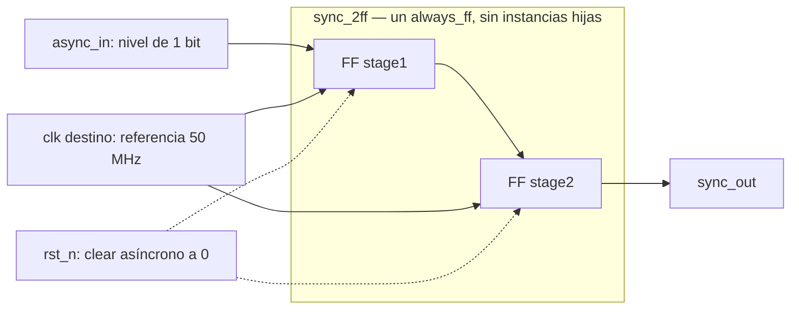

# Módulo: `sync_2ff`

Ficha adaptada al [OpenCE RTL Hardware Documentation Template](https://opencehardware.github.io/RTL-Hardware-Documentation-Template/).
RTL: `template/lib/sync_2ff/sync_2ff.sv`; pruebas: `template/tests/sync_2ff/`.

## Revisions

| Versión | Fecha | Cambio |
|---|---|---|
| 1.0 | 2026-10-05 | RTL de dos etapas, pruebas digitales y esquemático conceptual. |

## Document Conventions

CDC significa cruce de dominio de reloj; FF, flip-flop; MTBF, tiempo medio
entre fallas. `_n` indica activo bajo. «Dos etapas» cuenta las capturas:
la primera muestrea la entrada y la segunda captura el valor anterior de la
primera. No significa que todo cambio asíncrono se reproduzca exactamente
40 ns después.

## Introduction

**Familia E1 vigente (2026-10-16):** este módulo existente se reutiliza como
referencia para botones y señales asíncronas **de un bit**, según la adenda
del anteproyecto, §§V3–V4, criterio OE2.
La sincronización **no elimina rebotes**: múltiples transiciones mecánicas
pueden aparecer como múltiples cambios digitales. No se incorpora debouncer,
ni se garantiza la captura de pulsos cortos. Una composición con
`edge_detector` genera eventos sobre las muestras, no una pulsación física
única. Las referencias históricas a OE3/Tabla 1 en este documento describen
la evidencia previa, no restablecen los objetivos sustituidos.

Sincronizador estándar de **un nivel de un bit** hacia el dominio `clk`.
Reduce la probabilidad de propagación de metastabilidad; no la elimina.
No sincroniza buses, no garantiza transferencia de pulsos cortos y no incluye
handshake. La entrada debe permanecer estable el tiempo suficiente para que
el destino la capture; para garantizar eventos hace falta un protocolo externo.

Es uno de los cinco bloques de referencia autorizados por ADR-0007 y su adenda.
Apoya la cobertura de biblioteca de OE3 (Tabla 1 del anteproyecto), sin
confundir verificación digital con validación física de un CDC.

## Block Diagram

**Esquema RTL conceptual, no netlist sintetizada ni circuito físico.**



La primera etapa no debe alimentar lógica funcional ni otros consumidores.
El esquema muestra conectividad y estado, no ubicación física ni probabilidad
de falla. La frontera contiene los dos registros reales, no submódulos
instanciados; aparecen los cuatro puertos RTL.

## Configuration

No hay parámetros, typedefs ni interfaz SystemVerilog. **No existe `WIDTH`:**
el límite a un bit impide interpretar accidentalmente este bloque como
sincronizador de un bus. El sufijo `w1` en artefactos es descriptivo.

| Puerto | Dirección | Ancho | Contrato |
|---|---|---:|---|
| `clk` | entrada | 1 | Reloj destino, captura en flanco positivo. |
| `rst_n` | entrada | 1 | Reset asíncrono activo bajo; liberación sincronizada externamente. |
| `async_in` | entrada | 1 | Nivel proveniente de otro dominio o entrada externa. |
| `sync_out` | salida | 1 | Segunda etapa; usar únicamente en el dominio destino. |

## Protocols

**No aplica un protocolo de transacciones.** Se muestrea un nivel sin
acknowledge. Un pulso entre dos flancos puede no detectarse. Tampoco se
garantiza coherencia de varias instancias usadas sobre los bits de un bus.

## Memory Map

**No aplica:** no hay bus direccionable ni memoria.

## Registers

No hay registros de software. Estado interno:

| Registro | Ancho | Reset | Actualización |
|---|---:|---:|---|
| `stage1` | 1 | 0 | `async_in` en cada flanco destino. |
| `stage2` | 1 | 0 | Valor anterior de `stage1`. |

## Clock Domains

Solo se recibe `clk`, reloj destino (referencia 50 MHz / 20 ns). El reloj
origen no es un puerto. El CDC está entre `async_in` y `stage1`; la ruta
`stage1 → stage2` es **síncrona y debe temporizarse**, no declararse false path.
La integración debe justificar cualquier excepción exclusivamente sobre la
entrada asíncrona y usar Quartus Timing Analyzer para reconocer/revisar la
cadena, su colocación y estimación de MTBF. No se adjunta un SDC genérico que
oculte las rutas del integrador.

## Reset Domains

Ambas etapas se borran asíncronamente con `rst_n=0`.
**`always_ff` no sincroniza la liberación:** el nivel superior debe proveer
assert asíncrono y deassert sincronizado al reloj destino, cumpliendo
recovery/removal. No hay sincronizador de reset dentro de este bloque.
Después de liberar, la salida parte de cero hasta propagarse las capturas.

## Interrupts

**No aplica:** no genera interrupciones ni garantiza capturar eventos.

## Arbitration

**No aplica:** hay una entrada y un consumidor lógico.

## Debugging

Observar `async_in`, `stage1`, `stage2`, `sync_out` y `rst_n` en simulación.
No añadir lógica funcional a `stage1`; instrumentarlo físicamente puede
alterar la colocación y debe revisarse. Una forma de onda digital estable
no es evidencia de ausencia de metastabilidad.

## Synthesis

Desde `template/`, dentro del entorno abierto:

```bash
make synth DESIGN=sync_2ff
make netlist DESIGN=sync_2ff
make synth-all
```

`synth` aplica `synth_intel_alm -family cyclonev`, comprueba la red y emite
`results/yosys-sync_2ff-w1.json`. `netlist` genera
`results/netlist-sync_2ff-w1.dot` y, cuando Graphviz está disponible,
`results/netlist-sync_2ff-w1.svg` (Yosys pre-mapping + Graphviz).
Los atributos `async_reg` son pistas de intención: **su conservación y
tratamiento por Quartus deben verificarse**, no asumirse.
Síntesis lógica no acredita MTBF, STA, bitstream ni hardware.

## Verification

Separación ADR-0002: `stimulus.py` genera muestras deterministas,
`model.py` conserva historia, `checker.py` compara valores sin importar
CocoTB y `tb_sync_2ff.py` conduce los pines.

```bash
make sim DESIGN=sync_2ff TB_SEED=1234 TB_CYCLES=500
make sim DESIGN=sync_2ff SIM=icarus
make library-test
make library-regression
```

Pruebas: dos capturas, retención de niveles, transiciones, reset de ambas
etapas pobladas entre flancos y ausencia de historia residual tras reset.
Los cambios se aplican fuera del flanco para evitar carreras de simulación.
Las pruebas Python inyectan observaciones de bypass, una sola etapa,
stuck-at-zero e inversión. **No son una campaña de mutación RTL ni una
medición del kill rate ≥80 % de OE3.**

Estado al 2026-10-05: después de quedar disponible Docker, la corrida final
en `digital-design-verify:demo` (`321e6b8abeb5`) produjo **71 passed,
0 skipped**, incluidas ambas simulaciones del sincronizador con Verilator
5.028 e Icarus 12.0. Evidencia:
`template/results/demo-library-1005/final/junit-library.xml`.
Yosys 0.40 validó las nueve configuraciones de `synth-all`; la red del
sincronizador contiene dos `MISTRAL_FF`.
`netlist-all` generó inicialmente seis DOT en `:demo`.
La comprobación posterior con `:full-demo` (`c989ca3e1c32`,
Graphviz 2.43.0) produjo seis DOT y seis SVG no vacíos en
`template/results/demo-library-1005/full-demo-netlists/`.
No hay evidencia FPGA, MTBF ni acuerdo JTAG.
El checker es reutilizable, pero eso no constituye por sí solo reúso medido.

### Test Environment

| Herramienta | Versión observada | Configuración |
|---|---|---|
| Imagen Docker | `digital-design-verify:demo`, `321e6b8abeb5` | Copia Linux estable en `/tmp/library`, sin cachés previas. |
| Python / PyTest | 3.10.12 / 8.3.4 | Modelo de capturas y checker puro; driver CocoTB. |
| Verilator / Icarus | 5.028 / 12.0 | Un bit, reloj 20 ns, `TB_SEED=1234`, `TB_CYCLES=500`; cambios fuera del flanco. |
| Yosys | 0.40 | Cyclone V, sin WIDTH; dos `MISTRAL_FF` observados en la red. |

### Tests and Results

| Tipo | Resultado observado | Evidencia |
|---|---|---|
| Unitarias Python | 8/8 PASS: historia, reset, semilla y errores digitales inyectados | Clase `tests.sync_2ff.test_sync_2ff`. |
| Integración CocoTB | 2/2 invocaciones PASS, una por simulador | **10/10** pruebas del módulo en `final/junit-library.xml`. |
| Verificación analógica/formal | N/A: no ejecutada | No se modela metastabilidad analógica. |

### Benchmarks

| Métrica | Resultado / límite |
|---|---|
| Latencia digital | Segunda etapa captura la muestra anterior de la primera; comprobado por secuencias dirigidas. |
| MTBF, ventana metastable, slack y latencia física | **No medidos**. La fase asíncrona y metastabilidad impiden prometer 40 ns fijos. |
| Tiempo de suite | 159.21 s para toda la biblioteca; no caracteriza rendimiento del CDC. |

### Issues and Resolutions

| Problema / riesgo | Resolución / estado |
|---|---|
| Confundir simulación digital con validez física CDC | Contrato limitado a niveles de un bit; revisión Quartus/MTBF pendiente. |
| Atributos `async_reg` podrían no aplicarse como se espera | Se registran como pistas; reconocimiento/colocación físicos pendientes. |
| Edición de Make interfería con la primera suite | Corrida final desde copia estable sin cachés previas. |

### Verification Summary

Ambos simuladores y la síntesis lógica aprobaron el contrato digital;
no se acredita MTBF, colocación, captura universal de pulsos ni acuerdo FPGA.

## Microarchitecture

Dos asignaciones no bloqueantes en un único `always_ff`:
`stage1[n]=async_in[n]`, `stage2[n]=stage1[n-1]`.
La salida es una conexión a `stage2`. No hay lógica combinacional entre
etapas. La latencia digital se especifica por capturas; con entrada realmente
asíncrona el momento de captura es incierto y puede prolongarse por
metastabilidad. El modelo Python no representa ese fenómeno analógico.

**Objeción:** una simulación verde no valida un CDC físico.
**Respuesta:** se limita el veredicto a estructura y contrato digital; quedan
pendientes revisión CDC, restricciones, colocación y análisis de MTBF en
Quartus. Añadir otro framework no resolvería esa limitación física.

## References

- [OpenCE RTL Hardware Documentation Template](https://opencehardware.github.io/RTL-Hardware-Documentation-Template/)
- [Alcance y adenda de cinco bloques](../decisions/ADR-0007-alcance-biblioteca-y-operacion.md)
- Anteproyecto: OE3 y Tabla 1
- RTL: `template/lib/sync_2ff/sync_2ff.sv`
- Pruebas: `template/tests/sync_2ff/`
- Composición posterior: [edge_detector](edge_detector.md)
